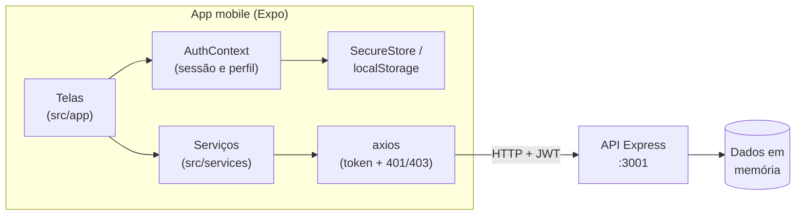

# Blog da Turma — App Mobile

Aplicativo mobile do blog educacional do Tech Challenge (Fase 4 — Pós-Tech Full Stack). Professores publicam e gerenciam posts e cadastram professores e alunos; alunos leem os posts.

O app consome a API REST do blog desenvolvida na fase anterior ([luccsll/Tech-Challenge](https://github.com/luccsll/Tech-Challenge), pasta `backend/`).

## Sumário

- [Funcionalidades](#funcionalidades)
- [Tecnologias](#tecnologias)
- [Pré-requisitos](#pré-requisitos)
- [Como rodar](#como-rodar)
- [Usuários de teste](#usuários-de-teste)
- [Arquitetura](#arquitetura)
- [Endpoints usados](#endpoints-usados)
- [Guia de uso](#guia-de-uso)
- [Limitações conhecidas](#limitações-conhecidas)

## Funcionalidades

| Funcionalidade | Aluno | Professor |
|---|:-:|:-:|
| Login e logout (sessão salva no aparelho) | ✅ | ✅ |
| Lista de posts com busca por palavra-chave | ✅ | ✅ |
| Leitura do post completo | ✅ | ✅ |
| Criar, editar e excluir posts | — | ✅ |
| Listar (paginado), cadastrar, editar e excluir professores | — | ✅ |
| Listar (paginado), cadastrar, editar e excluir alunos | — | ✅ |

## Tecnologias

- **Expo SDK 58** com **React Native 0.88** e **React 19**
- **TypeScript**
- **Expo Router** — navegação baseada em arquivos, com rotas protegidas (`Stack.Protected`)
- **axios** — chamadas HTTP, com token JWT no cabeçalho e tratamento de 401/403
- **expo-secure-store** — guarda o token de forma segura no celular (na web usa `localStorage`)
- Componentes funcionais e hooks (`useState`, `useEffect`, `useCallback`, Context API)

## Pré-requisitos

- [Node.js](https://nodejs.org/) (LTS) e npm
- [Docker](https://www.docker.com/) para subir a API (ou Node.js para rodá-la direto)
- Celular com o app **Expo Go** ([Android](https://play.google.com/store/apps/details?id=host.exp.exponent) / [iOS](https://apps.apple.com/app/expo-go/id982107779)) **na mesma rede Wi-Fi** do computador — ou um emulador Android / simulador iOS

## Como rodar

### 1. Subir a API

No repositório do backend ([luccsll/Tech-Challenge](https://github.com/luccsll/Tech-Challenge)):

```bash
docker compose up --build -d backend
```

A API fica em `http://localhost:3001`. Para conferir: `curl http://localhost:3001/health` deve responder `{"status":"ok"}`.

<details>
<summary>Sem Docker</summary>

```bash
cd backend
npm install
npm start
```
</details>

### 2. Descobrir o IP do computador

No celular, `localhost` é o próprio celular — o app precisa do IP do computador na rede local.

- **macOS:** `ipconfig getifaddr en0`
- **Windows:** `ipconfig` (campo "Endereço IPv4")
- **Linux:** `hostname -I`

### 3. Configurar o app

Na raiz deste projeto, crie o arquivo `.env.local` com o IP encontrado:

```bash
EXPO_PUBLIC_API_URL=http://192.168.0.10:3001
```

> O arquivo `.env.local` não vai para o Git, porque o IP muda de rede para rede. Se o IP mudar, atualize o arquivo e reinicie com `npx expo start --clear` — variáveis `EXPO_PUBLIC_` são embutidas no bundle quando ele é gerado.

### 4. Instalar e iniciar

```bash
npm install
npx expo start
```

- **Celular:** escaneie o QR Code com o Expo Go (Android) ou com a câmera (iOS).
- **Emulador Android:** tecle `a`. **Simulador iOS:** tecle `i`. **Navegador:** tecle `w`.

### Verificações

```bash
npx tsc --noEmit   # tipos
npx expo lint      # lint
```

## Usuários de teste

A API já sobe com estes usuários:

| Perfil | Usuário | Senha |
|---|---|---|
| Professor | `marina.souza` | `professor123` |
| Aluno | `joao.aluno` | `aluno123` |

## Arquitetura



### Pastas

```
src/
├── app/                      # Rotas (Expo Router): cada arquivo é uma tela
│   ├── _layout.tsx           # Tema, AuthProvider e guarda de login
│   ├── login.tsx
│   └── (app)/                # Só para usuários logados
│       ├── _layout.tsx       # Stack + guarda de professor
│       ├── index.tsx         # Lista de posts com busca
│       ├── posts/
│       │   ├── [id]/index.tsx  # Leitura
│       │   ├── [id]/edit.tsx   # Editar post        (professor)
│       │   └── new.tsx         # Novo post          (professor)
│       ├── admin/
│       │   ├── index.tsx       # Hub "Gerenciar"    (professor)
│       │   └── posts.tsx       # Administração de posts (professor)
│       ├── professores/        # index, new, [id]/edit (professor)
│       └── alunos/             # index, new, [id]/edit (professor)
├── components/               # PostForm, UserForm, UserList, FormField, ThemedText/View…
├── constants/                # Tema (cores, espaçamentos) e textos por perfil
├── contexts/auth-context.tsx # Sessão: user, token, isProfessor, login, logout
├── hooks/                    # Tema claro/escuro
├── services/                 # api.ts (axios), posts.ts, users.ts, storage
└── utils/                    # confirm e showError (nativo e web)
```

### Rotas

| Rota | Tela | Acesso |
|---|---|---|
| `/login` | Login | Somente deslogado |
| `/` | Lista de posts com busca | Logado |
| `/posts/:id` | Leitura do post | Logado |
| `/admin` | Hub "Gerenciar" (Posts, Professores, Alunos) | Professor |
| `/admin/posts` | Lista de posts com Editar/Excluir | Professor |
| `/posts/new` | Novo post | Professor |
| `/posts/:id/edit` | Editar post | Professor |
| `/professores` · `/professores/new` · `/professores/:id/edit` | Lista paginada, cadastro e edição | Professor |
| `/alunos` · `/alunos/new` · `/alunos/:id/edit` | Lista paginada, cadastro e edição | Professor |

### Autenticação e sessão

- O login chama `POST /auth/login`, que devolve o token JWT (válido por 8 h) e o usuário com seu `role` (`professor` ou `aluno`).
- O `AuthContext` guarda token e usuário no **expo-secure-store** (no celular) ou no `localStorage` (na web) e restaura a sessão ao abrir o app.
- O token vai em todas as requisições no cabeçalho `Authorization: Bearer <token>`.
- Se uma requisição autenticada voltar **401** (token expirado ou conta excluída), o app faz logout automaticamente.

### Regras de permissão

As regras são aplicadas nas duas pontas:

- **No app:**
  - O root layout só libera o grupo `(app)` para quem está logado.
  - O layout de `(app)` usa `Stack.Protected guard={isProfessor}` em todas as telas de escrita e gestão. Se um aluno tentar abrir uma delas, mesmo digitando a URL na web, é levado de volta para a lista de posts.
  - O botão "Gerenciar" nem aparece para alunos.
- **Na API:** as rotas de escrita de posts e todas as de `/professores` e `/alunos` exigem professor. Um aluno recebe **403**, que o app mostra como *"Você não tem permissão para esta ação."*

### Camada de API

- `services/api.ts`: instância do axios (`baseURL` vinda de `EXPO_PUBLIC_API_URL`), interceptor de 401, `getApiMessage` (mensagem de erro da API, com o texto padrão para 403) e login.
- `services/posts.ts`: `getPosts(q)`, `getPost`, `createPost`, `updatePost`, `deletePost`.
- `services/users.ts`: `getUsers(role, page)`, `getUser`, `createUser`, `updateUser`, `deleteUser`. A mesma função atende professores e alunos, só muda o caminho (`/professores` ou `/alunos`).
- As listas cancelam a requisição anterior (`AbortController`) ao buscar de novo, e recarregam ao voltar para a tela.

## Endpoints usados

| Método | Rota | Acesso | Uso no app |
|---|---|---|---|
| POST | `/auth/login` | Público | Login. Corpo `{ username, password }` → `{ token, user }` |
| GET | `/posts?q=` | Público | Lista e busca (título, autor, descrição e conteúdo) |
| GET | `/posts/:id` | Público | Leitura e carregamento da edição |
| POST | `/posts` | Professor | Novo post `{ title, author, description, content }` |
| PUT | `/posts/:id` | Professor | Editar post |
| DELETE | `/posts/:id` | Professor | Excluir post |
| GET | `/professores?page=&limit=` | Professor | Lista paginada → `{ data, page, limit, total, totalPages }` |
| GET | `/professores/:id` | Professor | Carregar edição |
| POST | `/professores` | Professor | Cadastro `{ nome, username, email, senha }` |
| PUT | `/professores/:id` | Professor | Edição (senha opcional) |
| DELETE | `/professores/:id` | Professor | Exclusão |
| GET/POST/PUT/DELETE | `/alunos` e `/alunos/:id` | Professor | Iguais aos de professores |

Respostas de erro tratadas pelo app: **400** (campos obrigatórios), **401** (sessão expirada → logout), **403** (sem permissão), **404** (não encontrado) e **409** (username já em uso). A mensagem enviada pela API é exibida para o usuário.

## Guia de uso

### Aluno

1. Entre com `joao.aluno` / `aluno123`.
2. A tela inicial lista os posts. Digite na busca para filtrar por título, autor ou palavra-chave; puxe a lista para baixo para atualizar.
3. Toque num post para ler o conteúdo completo.
4. Toque em **Sair** para encerrar a sessão.

### Professor

1. Entre com `marina.souza` / `professor123`.
2. Além da lista e da leitura, aparece o botão **Gerenciar**, que abre três áreas:
   - **Posts**:
     - **Novo post** abre o formulário. Título, autor e conteúdo são obrigatórios; a descrição é opcional.
     - Cada post tem **Editar** e **Excluir**. Excluir pede confirmação.
   - **Professores** e **Alunos**:
     - A lista mostra 10 por página, com **Anterior**/**Próxima** e "Página X de Y". Puxe para baixo para atualizar.
     - **Novo professor** ou **Novo aluno** abre o cadastro, com nome, username, e-mail e senha.
     - **Editar** abre os dados atuais. Deixe a senha em branco para manter a atual.
     - **Excluir** pede confirmação.

## Limitações conhecidas

- **Dados em memória:** a API não usa banco de dados. Ao reiniciar o servidor (ou o container), posts, professores e alunos voltam aos dados iniciais.
- **IP fixo no `.env.local`:** se o computador trocar de rede, atualize o IP e reinicie o Expo com `--clear`.
- **Expo Go:** o app usa apenas módulos incluídos no Expo Go, então não precisa de development build.
- **Excluir a própria conta:** é permitido. O professor que se exclui é deslogado na próxima requisição.
